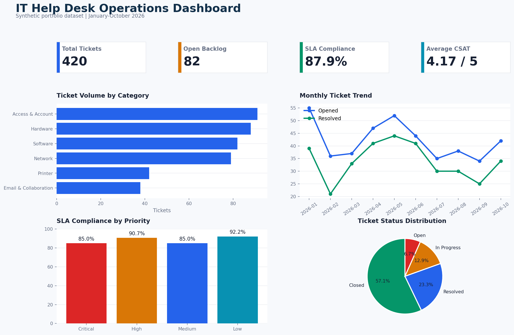
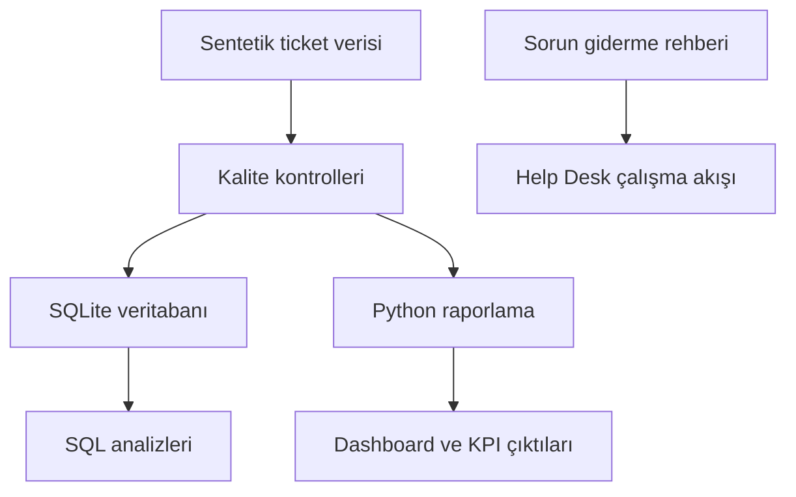

# IT Help Desk Talep, SLA ve Sorun Giderme Projesi

Bu portföy projesi, bir Bilgi İşlem / IT Destek ekibinin günlük talep yönetimini uçtan uca simüle eder. Projede kişisel veya kurumsal gerçek veri kullanılmaz; tüm kayıtlar deterministik olarak üretilmiş sentetik verilerdir.



## Projenin amacı

- Destek taleplerini kategori, öncelik ve durum bilgisiyle yönetmek
- SLA uyumunu, çözüm sürelerini, açık iş yükünü ve memnuniyeti izlemek
- SQL ile operasyonel analizler hazırlamak
- Windows, donanım, ağ ve kullanıcı erişimi sorunları için standart çözüm adımları oluşturmak
- Tekrarlanabilir veri üretimi ve otomatik kalite kontrolleri kullanmak

## Öne çıkan yetkinlikler

`Help Desk` · `IT Support` · `Ticket Management` · `SLA` · `Troubleshooting` · `Windows` · `TCP/IP` · `SQL` · `SQLite` · `Python` · `Data Quality` · `Reporting`

## Proje mimarisi



## Üretilen içerikler

| Bileşen | Açıklama |
|---|---|
| `data/helpdesk_tickets.csv` | 420 sentetik destek talebi |
| `database/helpdesk.db` | Analize hazır SQLite veritabanı |
| `sql/schema.sql` | Tablo, indeks ve görünüm tanımları |
| `sql/analysis_queries.sql` | KPI, SLA, backlog ve performans sorguları |
| `reports/dashboard.html` | İnternetsiz açılan, tek dosyalı HTML dashboard |
| `screenshots/dashboard_preview.png` | GitHub için dashboard ön izlemesi |
| `docs/troubleshooting_guide.md` | 12 yaygın IT destek senaryosu |
| `docs/incident_workflow.md` | Önceliklendirme, SLA ve eskalasyon süreci |
| `powerbi/` | Power BI kurulum adımları ve DAX ölçüleri |

## Örnek proje sonuçları

Deterministik veri setinin mevcut sürümünde:

| KPI | Sonuç |
|---|---:|
| Toplam ticket | 420 |
| Çözülen/kapatılan ticket | 338 |
| Açık backlog | 82 |
| Çözüm oranı | %80,5 |
| SLA uyumu | %87,9 |
| Ortalama çözüm süresi | 17,52 saat |
| Ortalama CSAT | 4,17 / 5 |
| Tekrar açılma oranı | %7,4 |

Bu değerler bir şirketin gerçek performansını temsil etmez; yalnızca portföy analizi için üretilmiştir.

## Hızlı başlangıç

Python 3.11 veya daha yeni bir sürüm önerilir.

```bash
python -m venv .venv
# Windows: .venv\Scripts\activate
# macOS/Linux: source .venv/bin/activate
pip install -r requirements.txt
python src/generate_data.py
python src/quality_check.py
python src/load_database.py
python src/analyze.py
python -m unittest discover -s tests -v
```

Windows kullanıcıları aynı işlemleri `run_project.bat` ile çalıştırabilir.

## Örnek SQL analizi

```sql
SELECT
    priority,
    COUNT(*) AS resolved_tickets,
    ROUND(100.0 * SUM(CASE WHEN sla_met = 'Yes' THEN 1 ELSE 0 END) / COUNT(*), 1)
        AS sla_compliance_pct,
    ROUND(AVG(resolution_minutes) / 60.0, 2) AS avg_resolution_hours
FROM tickets
WHERE status IN ('Resolved', 'Closed')
GROUP BY priority;
```

## Komut satırı kullanımı

```bash
python src/ticket_cli.py stats
python src/ticket_cli.py list --status Open --limit 5
python src/ticket_cli.py show HD-2026-0001
```

## Dokümantasyon

- [Veri sözlüğü](docs/data_dictionary.md)
- [Talep yönetimi ve SLA iş akışı](docs/incident_workflow.md)
- [IT destek sorun giderme rehberi](docs/troubleshooting_guide.md)
- [Projeyi mülakatta anlatma rehberi](docs/interview_guide.md)
- [Power BI dashboard oluşturma rehberi](powerbi/build_guide.md)

## Veri güvenliği

Bu proje yalnızca sentetik veri içerir. Gerçek kullanıcı adı, e-posta, telefon, cihaz kimliği, şirket bilgisi veya üretim sistemi kaydı kullanılmaz. Ayrıntılar için [SECURITY.md](SECURITY.md) dosyasına bakın.

## Lisans

Kod ve dokümantasyon MIT Lisansı ile sunulur.
