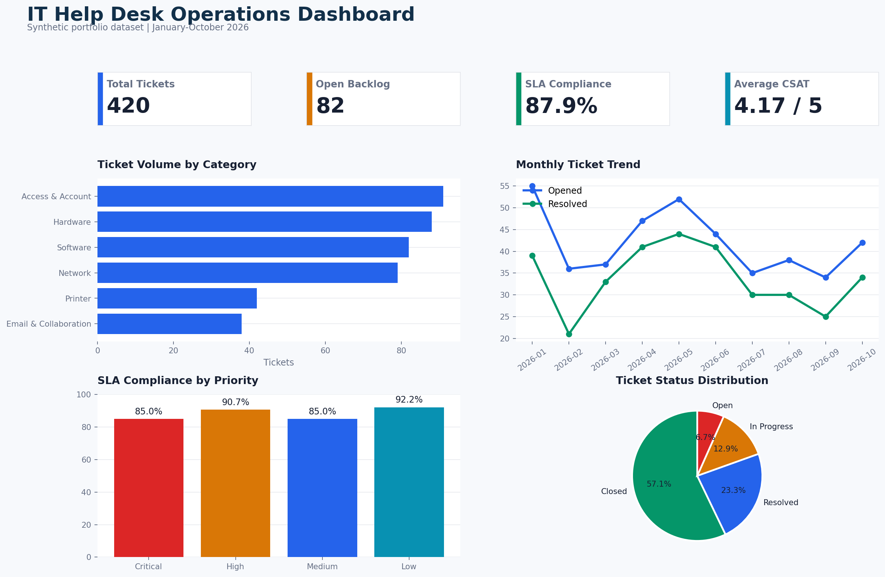

# IT Help Desk Ticket, SLA, and Troubleshooting Portfolio

This project simulates an end-to-end IT service desk workflow with 420 deterministic synthetic tickets. It demonstrates ticket categorization, prioritization, SLA monitoring, SQL analysis, data quality controls, reporting, and structured troubleshooting documentation.



## Skills demonstrated

`IT Support` · `Help Desk` · `Ticket Management` · `SLA` · `Windows Troubleshooting` · `TCP/IP` · `SQL` · `SQLite` · `Python` · `Reporting`

## Run the project

```bash
pip install -r requirements.txt
python src/generate_data.py
python src/quality_check.py
python src/load_database.py
python src/analyze.py
python -m unittest discover -s tests -v
```

The dataset contains no personal or production data. See the Turkish [README](README.md) for complete documentation.
